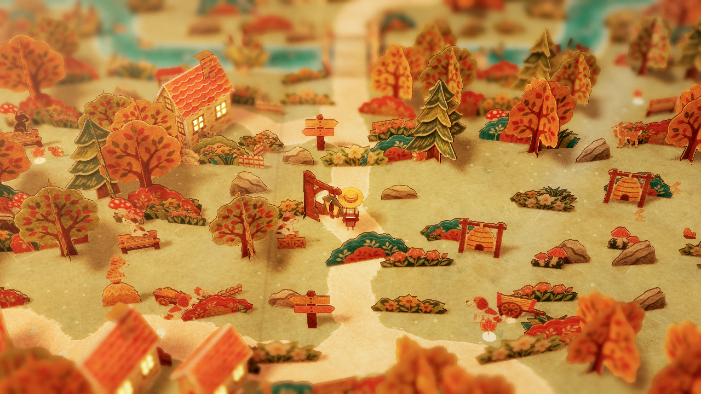
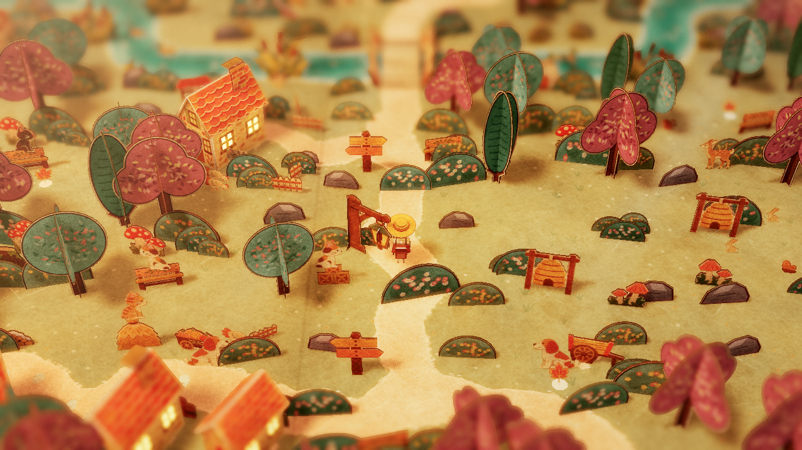

# Papertrails

[Play Papertrails](https://xikhar.github.io/papertrails/)

## Diorama mode: your own art as paper cards

This fork turns Papertrails into a paper-card diorama for your own 2D art:

- **No pop-up.** Everything simply stands, upright from the start, as you walk (`?popup=1` brings the pop-up back).
- **Dream pass** (from WILD MINDS 2.5D): a soft glow, slow sun shafts and a warm light leak, golden dust in the light
  and a thin mist, on top of the tilt-shift, soft shadows and lantern light (`?dream=0` to compare).
- **Your own sprite sheet.** Draw your trees, bushes, rocks, props, walls and animals on one sheet, map them in
  `public/textures/art/mine/art.json`, and the game cuts them into paper cards at load: cream die-cut rim, cards
  re-cut to your outlines, trees as crossed cards. See [docs/YOUR_ART.md](docs/YOUR_ART.md) and `art-guide.html`.
  `?art=example` shows a placeholder example set.

